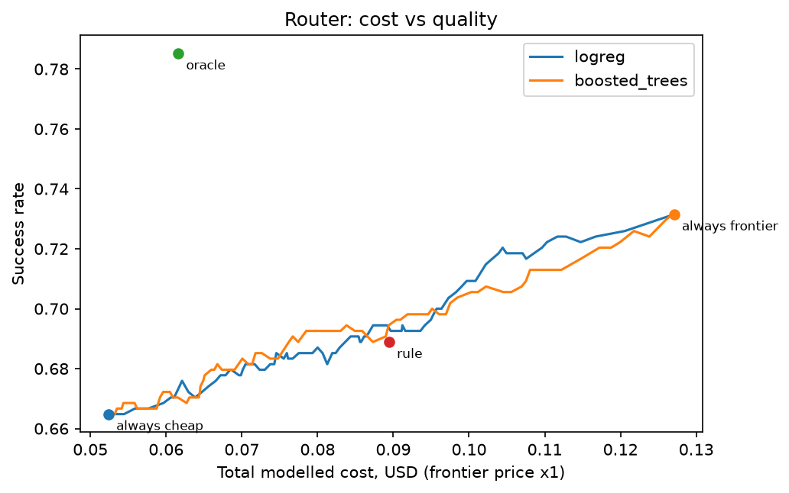

# llm-cost-router
ML router that sends each LLM request to the cheapest model that can handle it, measured by **cost per successful outcome**, not just token spend.

Like a triage nurse: easy requests go to a cheap model (`gpt-oss-20b`), hard ones to a frontier model (`gpt-oss-120b`), and an LLM judge checks the outcomes. Built entirely on free tiers ($0).

> **Status: v1 results on 540 labelled prompts** (all 70 GSM8K + 470 judged, 35–70 per category across all 13 categories). All 910 sampled prompts have answers from both models. Judging the remaining 370 is limited by the Gemini free tier (20 requests/day, often overloaded), so the numbers may still shift.

## Results (v1, 540 labelled prompts)



| Strategy (real Groq prices) | Success rate | Cost per success | Savings vs. always-frontier |
|---|---|---|---|
| Always cheap (20b) | 66.5% | $0.000146 | 59% |
| Always frontier (120b) | 73.1% | $0.000322 | — |
| Rule baseline (long or number-heavy → frontier) | 68.9% | $0.000240 | 30% |
| Logistic-regression router (quality setting) | 71.5% | $0.000265 | 20% |
| Logreg trained on "frontier rescues it" (quality setting) | 71.3% | $0.000246 | 31% |
| Oracle (perfect router, upper bound) | 78.5% | $0.000145 | 52% |

**What I learned from the numbers**
- **The router learns a weak signal:** ROC-AUC is 0.59–0.60 (logreg, boosted trees) vs. 0.54 (rule). The logreg router keeps about 3/4 of the frontier model's quality gain for 20% less cost. *(At 350 prompts logreg scored 0.62, so the error bars are still wide.)*
- **The price gap matters more than the router.** On Groq the frontier model is only 2× the price of the cheap one, so always-cheap has the best cost per success. With a premium frontier model at 10× the price ([what-if chart](results/cost_vs_quality_x10.png)), routing saves 25–51% while keeping most of the quality gain.
- **Routing can't fix prompts that both models fail.** The cheap model fails 33.5% of prompts, and the frontier model also fails 21.5% of them. It rescues only 12%.
- **Predicting "frontier rescues it" beats predicting "cheap fails".** Training on rescues (cheap fails *and* frontier passes) gives the same quality (71.3% vs. 71.5%) for less money: 31% savings instead of 20% at real prices, and 51% instead of 32% at 10×. Logreg ROC-AUC is 0.62 vs. 0.59. At 350 prompts (43 rescues) this target lost; at 540 (65 rescues) it wins, so more labels changed the conclusion. Boosted trees don't benefit yet. The app still uses the "cheap fails" target, because it reports that probability directly.
- **The oracle (78.5%) beats always-frontier (73.1%),** because on 5% of prompts the cheap model passes and the frontier model fails. Bigger isn't always better.

## How it works
1. **Data (Phase 1):** 2,178 public prompts: Databricks Dolly (8 task types), GSM8K math, and business tasks built from Tavily/Exa search snippets with 4 fixed templates. The v1 sample is 910 prompts, 70 per category.
2. **Labels (Phase 2):** each prompt goes to both models via Groq (`reasoning_effort=low`, 1,000 tokens max, concise system prompt, so 0% of answers get truncated).
   - **GSM8K:** graded by exact match on the final number.
   - **Everything else:** graded by Gemini 3.8 Flash. The judge is blinded (no model names), shuffled, and grades each answer pass/fail with the human reference answer. It must list unsupported claims and factual errors *before* its verdict.
   - **Judge validation:** a cheaper judge (Flash-Lite) passed answers that I verified had errors, so it was rejected. 96 blinded hand labels measure how often the judge agrees with a human (`python judge_agreement.py labels/hand_labels.csv your_label`).
   - **Second-opinion check:** Claude also graded the same 96 answers (`labels/claude_labels.csv`; this is an LLM, not a human). On the 56 answers both have graded, it agrees with the Gemini judge 82% of the time. Most disagreements are long brainstorming answers with invented details (fake apps, wrong prices) that the judge passed.
3. **Router (Phase 3):** features are local MiniLM sentence embeddings (384 dims) plus 6 simple text stats. Prompt category is deliberately *not* used, since real traffic doesn't arrive labelled. Models: a rule baseline, logistic regression, and gradient-boosted trees, all scored with 5-fold out-of-fold predictions.
4. **Evaluation (Phase 4):** success rate, total cost and cost per success for each strategy, at two thresholds: "match frontier quality within 2 pts" and "best $/success". Costs are modelled from Groq's published per-token prices on real token counts.
5. **Demo (Phase 5):** `streamlit run app.py` takes a prompt and shows P(cheap fails), the chosen model and the estimated savings. It can also run the prompt live.

Every API response is cached in DuckDB by `(prompt hash, model, settings)`, so no call is ever paid for twice and every run can resume where it stopped.

## Limitations and next steps
- **Small labelled set:** with 540 prompts the router's AUC has wide error bars (it moved 0.03 between 350 and 540). Judging the remaining 370 prompts (already answered and cached) is the cheapest improvement.
- **Judge reliability:** on 56 answers graded by both, an independent LLM second opinion agreed with the Gemini judge 82% of the time. The judge misses invented details in long answers. Human hand labels (`labels/hand_labels.csv`) are the final check.
- **Modelled costs:** costs use Groq's published per-token prices on real token counts. Free tiers aren't billed.
- **Next:** more labels → make "frontier rescues" the default target in the app → per-category thresholds → a third, cheaper tier.

## Roadmap
- [x] Phase 0: Setup — folder structure, `.env`, first "hello world" call to Groq and Gemini
- [x] Phase 1: Data — collect ~2–3k prompts (Hugging Face + business-style prompts via Tavily/Exa)
- [x] Phase 2: Labels — run prompts through both models, judge with Gemini, validate judge on ~100 hand labels *(910/910 answered; 540 labelled; human hand labels pending)*
- [x] Phase 3: Router — baseline rules → logistic regression on embeddings → gradient-boosted trees
- [x] Phase 4: Evaluation — cost-vs-quality curve, cost per successful outcome vs. baselines
- [ ] Phase 5: Demo — Streamlit app, deployed free *(app built; deploy pending)*
- [ ] Phase 6: Write-up — README results, LinkedIn post, update resume with real numbers *(README done; post and resume drafts in `docs/writeup_drafts.md`)*

## Quickstart
```bash
python -m venv .venv && source .venv/bin/activate
pip install -r requirements.txt
# create .env with GROQ_API_KEY and GEMINI_API_KEY (never commit it)
python hello_models.py                      # check both APIs work

# full pipeline (resumable; respects free-tier limits)
python collect_dolly.py && python collect_gsm8k.py
python collect_business_search.py && python build_business_prompts.py && python combine_prompts.py
python select_sample.py
python run_models.py data/sample_v1_ids.txt  # ~2–3 days on Groq's free tier
python judge.py data/sample_v1_ids.txt       # 18 calls/day on Gemini's free tier
python embed_prompts.py && python build_labels.py
python train_router.py && python evaluate.py && python evaluate.py 10
streamlit run app.py
```
